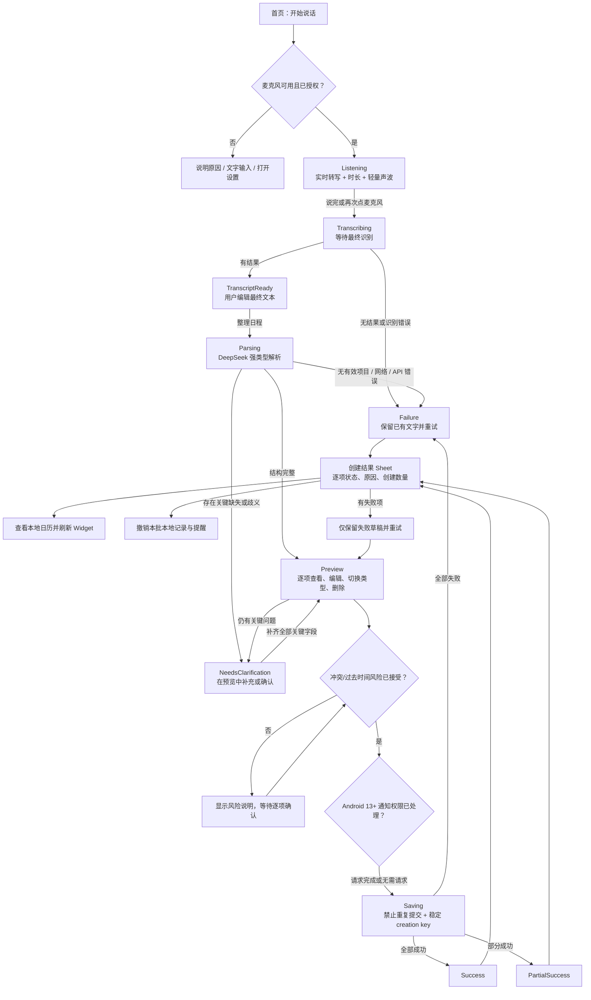
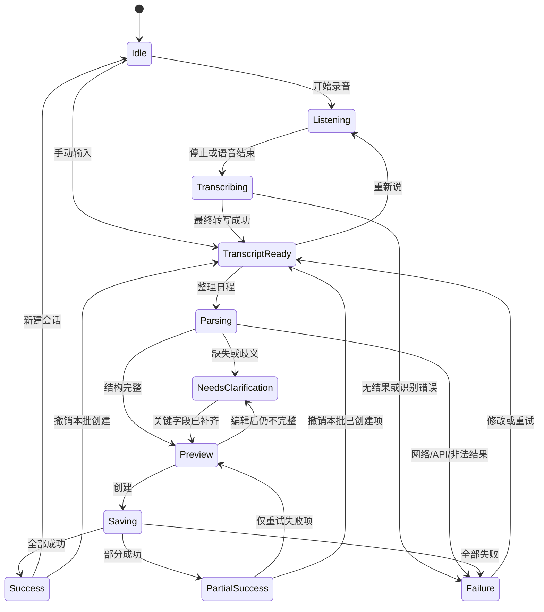

# 声历语音任务流本轮验证与交付报告

日期：2026-07-25

工作区：`D:\Desktop\Codex\Voice Memos`

应用：声历（`com.voicememos.aicalendar`）
本轮阶段提交：`86b06f8`（结构化语音流程基础）、`4e265f5`（强类型预览与安全本地持久化）

> 本文记录当前共享工作树截至 2026-07-25 的最终验证事实。代码、自动化测试、
> API 36 AVD、Release 内测包与人工目视检查均已有本轮证据；物理真机、真实语音、
> 系统广播/真实通知投递、生产签名仍未完成。Git 交付状态以仓库为准；本文不代表已经发布。

## 1. 状态摘要

状态标记：

- ✅：本轮代码、自动化测试或 API 36 AVD 已有明确通过证据。
- 🟡：代码已实现并有部分验证，但仍缺物理真机、平台行为、无障碍或生产发布门禁。
- ⏳：本轮未执行或未完成，不能视为已验收。

当前结论：

- ✅ 当前最终工作树 85 个 JVM 测试全部通过。
- ✅ API 36 AVD 常规 `connectedDebugAndroidTest` 共发现 8 个测试：7 个通过，
  真实 DeepSeek 测试按设计跳过；随后注入被 Git 忽略的本地 key，单独执行
  `RealDeepSeekCalendarFlowTest` 为 1/1 通过，因此全部 8 个 instrumentation 测试
  均已有独立通过证据。
- ✅ Room v1→v2 migration、顺序幂等、8 并发幂等、通知状态持久化与 3 条 Compose mock
  流程均在 API 36 AVD 通过。
- ✅ `lintDebug` 完成，结果为 0 error / 30 warnings；`assembleRelease` 成功。
- ✅ Release APK 位于 `app/build/outputs/apk/release/app-release.apk`，版本为
  `versionCode 4` / `versionName 0.2.0` / `targetSdkVersion 36`，SHA-256 为
  `1B6DA94ECAF6791E60E310A5B6D9A5420A7BE0022D1C79F5F22E83427923FC61`。
- ✅ APK 已通过 APK Signature Scheme v2 验证及 `zipalign -P 16` 验证，并在 API 36
  AVD 安装、启动成功；验证期间未观察到 crash 或 ANR。
- 🟡 当前 APK 使用 Android Debug 证书签名，只能作为内部测试包；项目尚无生产 keystore，
  不能视为可对外发布的生产包。
- ✅ 已保留 Kotlin、Jetpack Compose、StateFlow、Room、SpeechRecognizer、OkHttp、
  kotlinx.serialization、AlarmManager 的现有技术栈，没有更换框架。
- ✅ 已建立 11 状态的 `VoiceTaskState` 与 `VoiceScheduleSession`；最终转写不再自动解析，
  而是进入可编辑的 `TranscriptReady`。
- ✅ DeepSeek 输出已经升级为 `EVENT`、`REMINDER`、`TODO` 强类型 `items`，并保留旧
  `events` 兼容入口；映射器会校验类型、时间、IANA 时区、DST、时间先后关系、
  missing/ambiguous fields 和多事项。
- ✅ Room v2、显式 v1→v2 migration、备份兼容和 `creationKey` 唯一索引已实现；
  migration 以及顺序和 8 并发幂等 instrumentation tests 均已通过。
- ✅ 当前录音幕布会按状态显示时长、轻量声波、转写/解析进度、可编辑转写、
  状态化按钮和 Sheet 内错误；录音幕布不再渲染识别历史。
- ✅ 当前预览支持类型切换、逐项编辑/删除、标题、类型时间、提醒、重复、地点、备注、
  全天、时区、优先级、置信度和歧义提示；存在关键缺失或歧义时禁止批量创建。
- ✅ 冲突与过去时间检测已经接入解析/编辑后的草稿状态；用户必须逐项显式接受风险，
  才能进入保存。错误映射器也已接入解析、保存和连接测试异常路径。
- ✅ 保存链路已经接入逐项创建结果、`sessionId:draftId:occurrenceIndex` 幂等 key、
  失败项重试、创建后撤销，以及成功/部分成功/失败历史结果。
- ✅ 提醒调度结果会映射并写回 `notificationStatus`；通知权限被拒绝时仍保存事项，
  但结果 Sheet 会给出提醒未安排的逐项警告。
- ✅ TODO 允许没有截止时间；受限 RRULE
  `FREQ=DAILY|WEEKLY[;COUNT=2..60]` 会展开为本地 occurrence，其他规则被明确阻断。
- 🟡 exact alarm 降级、过去时间跳过、开机/升级/时间/时区变化后重排提醒的代码已实现；
  通知状态持久化测试已通过，但真实 AlarmManager、receiver 和通知投递尚未验证。
- ✅ 识别历史已有独立入口和独立 Sheet，可查看结构化结果、创建状态/失败原因、
  编辑原文、重新解析、单条删除和二次确认清空；设置也已按 AI、默认值、权限、数据、
  危险操作分组，并接入 API key 遮挡/显示/粘贴/清除、连接测试和 `ON_RESUME`
  权限自动刷新。旧的不可达 Settings/Composer 已移除，核心文案已迁移到 string resources。
- ✅ 首页 typed 今日信息、独立历史和分组设置已经实现；API 36 人工目视确认首页、引导页、
  拒绝麦克风权限后的文字输入降级均显示与交互正常。
- 🟡 完整无障碍回归、撤销跨进程持久化/事务化补偿仍未完成。
- ⏳ 物理真机、真实语音、boot/time/timezone/exact alarm 与真实通知投递尚未执行；
  当前版本也尚未作为生产版本发布。

## 2. 当前项目审计

### 2.1 技术与架构

| 关注点 | 当前实现 | 审计结论 |
| --- | --- | --- |
| UI | 单 Activity、Jetpack Compose、Material 3、多个 `ModalBottomSheet` | 可复用；没有 Navigation Compose |
| 状态 | `CalendarViewModel` + 单一 `StateFlow<CalendarUiState>` | 方向正确；语音状态已集中，但 Sheet/设置等页面状态仍由布尔值控制 |
| 语音 | Android `SpeechRecognizer`，partial results，3 秒静音参数 | 可复用；暂停/继续、来电/后台恢复仍未证明 |
| AI | OkHttp 调 DeepSeek Chat Completions，kotlinx.serialization 解码 | 可复用；强类型映射已加强 |
| 数据 | Room，本地 `calendar_events` 与 `app_settings` | 已由 schema v1 升到 v2；API 36 migration test 通过 |
| 日历边界 | 应用内本地日历 | 不写 Android Calendar Provider，也不申请日历读写权限 |
| 提醒 | `AlarmManager` + receiver + 高优先级通知渠道 | exact/inexact 与重排代码已补齐；设备可靠性待验证 |
| API Key | Android Keystore AES-GCM + 私有 SharedPreferences | 本机加密；默认遮挡并支持显示/隐藏、粘贴、清除和连接测试；真实 DeepSeek 测试通过 |
| 备份 | 手动 JSON 导入/导出、ICS 导出；系统备份关闭 | v2 格式向后兼容；不把密钥/数据库交给系统云备份 |
| 主题 | 现有浅色/深色主题和品牌色 | 保留；核心文案已资源化，完整无障碍与多尺寸审计仍待完成 |
| 测试 | JVM、Compose instrumentation、真实 DeepSeek 可选测试 | 85 个 JVM 与全部 8 个 instrumentation 测试均有通过证据 |

### 2.2 当前分层

当前主要路径仍然清晰：

- UI：`ui/CalendarApp.kt`
- UI 状态与编辑器转换：`ui/CalendarUiState.kt`
- 业务编排：`ui/CalendarViewModel.kt`
- 会话状态机：`ui/session/VoiceTaskState.kt`、
  `ui/session/VoiceScheduleSession.kt`
- 语音适配：`speech/SpeechInputController.kt`
- AI 协议与网络：`ai/AiCalendarResponse.kt`、`DeepSeekPrompt.kt`、
  `DeepSeekCalendarParser.kt`、`AiResponseMapper.kt`
- 领域：`domain/*`
- Room/备份/历史：`data/*`
- 通知：`reminder/*`
- 密钥：`security/SecureApiKeyStore.kt`

没有把 API 请求、JSON 映射、Room 写入或 AlarmManager 调用直接放进 Composable。

### 2.3 可复用能力

- 首页月/周/日/清单视图、已有事件编辑、主题切换、Widget。
- SpeechRecognizer 封装、partial/final transcript 回调和语音错误文案。
- DeepSeek HTTP 客户端、mock key 路径、JSON fence 恢复和多事项回归样例。
- Room Repository、手动 JSON 备份、ICS 导出、提醒调度。
- 折叠式草稿卡片与现有 UI testTag。
- Android Keystore 密钥保存。

### 2.4 当前高风险和技术债

- `CalendarApp.kt` 仍较大，集中承载首页、录音、草稿、历史、设置和编辑器。
- `CalendarViewModel.kt` 仍同时编排 AI、状态、保存、权限、备份和提醒。
- `VoiceScheduleSession` 持有状态与文本，但草稿列表和 clarification questions 仍在会话
  外部；不是完整持久化的“单会话对象”。
- 活跃会话没有使用 `SavedStateHandle` 或 Room 保存；旋转时 ViewModel 通常保留，
  进程被杀后不能保证恢复。
- 旧的不可达 Settings/Composer 已移除，核心文案已迁移；剩余界面仍需持续完成资源化与
  无障碍审计。
- 当前 Release APK 使用 Android Debug 证书签名；项目尚无生产 keystore，不能视为生产发布签名。
- 创建、提醒调度和撤销没有跨 Room 与 AlarmManager 的统一事务；中途进程退出仍可能留下
  “记录已写入但后续反馈/调度未完成”的恢复问题。
- 撤销依赖 ViewModel 内存中的 `lastCreatedEvents`；进程被杀后不再提供同一批次的撤销句柄，
  多记录撤销中途失败时也没有持久化补偿队列。
- 稳定 creation key 已用于同一 session 的失败重试，但进程重建后的全新 session
  不会自动识别语义上相同的重复请求。
- 当前 DeepSeek“测试连接”会发起一次实际解析请求，能验证现有解析链路，但可能消耗 token，
  不是专用的轻量健康检查。
- 受限 RRULE 会展开为多条本地记录；尚无独立 series 实体、整组编辑/取消或通用
  RFC 5545 支持。

## 3. 分阶段实施记录

| 阶段 | 状态 | 本轮结果 | 数据影响 | 尚缺验收 |
| --- | --- | --- | --- | --- |
| 0. 审计与计划 | ✅ | 完成架构、流程、风险、迁移和八阶段计划；见 `docs/voice-workflow-audit-and-plan.md` | 无 | 无 |
| 1. 状态机与语音基础 | ✅ | 建立 11 状态、统一 session、parse/save 防重入、失败保留文本；final transcript 停在可编辑状态 | 无 | 进程重建、后台/来电设备回归 |
| 2. 强类型 AI | ✅ | `items`、三类型、IANA 时区、ISO 时间、RRULE、missing/ambiguous、逐项容错、旧 `events` 兼容；真实 DeepSeek 测试通过 | 无 | 弱网/限流真实异常回归 |
| 3. Room v2 与平台可靠性 | 🟡 | 显式 migration、新列、唯一幂等索引、备份兼容、exact→inexact、重排 receiver、backup 排除规则；migration、顺序/8 并发幂等、通知状态测试通过 | 保留旧行并默认成 `EVENT` | 物理真机 boot/time/timezone/exact alarm 与真实通知投递 |
| 4. 转写、消歧与预览 | 🟡 | 状态化录音幕布、时长/声波、编辑转写、结构化卡片、类型切换、缺失/歧义阻断、动态“创建 N 项”；3 条 Compose mock 流程通过 | 无 | 真实语音、大字体/TalkBack |
| 4a. 错误/风险/历史基础 | ✅ | 14 类错误目录、冲突/过去时间检测、显式风险接受、增强历史字段与兼容 codec 均已接入 ViewModel/UI | 历史 JSON 向后兼容 | 真实异常与物理真机风险场景回归 |
| 5. 保存结果与撤销 | 🟡 | 逐项结果、失败项重试、稳定 occurrence creation key、提醒状态写回和创建后撤销已接入；connected 数据测试通过 | 结果写入历史；v2 字段承载幂等/通知状态 | 跨进程恢复与部分撤销补偿 |
| 6. 首页、历史、设置 | ✅ | typed 首页、独立识别历史、分组设置、key 遮挡/连接测试、权限自动回刷已完成并完成 API 36 核心目视检查 | 历史旧 JSON 可读 | 完整无障碍回归、轻量连接检查 |
| 7. 视觉与无障碍 | 🟡 | 核心 strings 已迁移；状态不只靠颜色；错误/警告使用 `liveRegion`；首页、引导与文字降级目视正常 | 无 | 48dp 全量审计、TalkBack、字体缩放、横屏、对比度 |
| 8. 完整回归与发布 | 🟡 | 85 个 JVM、8 个 instrumentation、lint、Release 构建、APK 校验、API 36 安装启动均已有证据 | 无 | 物理真机、真实语音、平台通知/广播、生产签名、提交/推送/发布 |

## 4. 新交互流程



当前创建目标是本地 Room 日历与本地提醒，不是 Android 系统日历 Provider。

## 5. 11 状态机说明



| 状态 | 当前可见反馈 | 当前允许的主要操作 | 保护与限制 |
| --- | --- | --- | --- |
| `Idle` | “说出安排”与示例语义 | 开始说话、手动输入 | 空文本不能解析 |
| `Listening` | “正在听”、计时、轻量声波、partial transcript | 完成录音、关闭 | 当前没有暂停/继续 |
| `Transcribing` | 明确进度与“正在完成转写…” | 等待 | 禁止重复提交 |
| `TranscriptReady` | 完整可编辑文本 | 重新录音、整理日程 | 使用编辑后的文本解析；不自动创建 |
| `Parsing` | “正在整理”、进度条 | 等待 | `parseJob` 与状态双重防重入 |
| `NeedsClarification` | warning、每项缺失/歧义字段、冲突/过去时间风险和阻断原因 | 编辑字段、类型切换、确认已核对、接受风险 | 尚无完整问题卡/选项/语音补充或自动改期建议 |
| `Preview` | 结构化卡片、置信度、类型时间、风险等字段 | 编辑、删除、单项或批量创建 | 关键问题或未接受风险存在时禁用创建 |
| `Saving` | “正在创建…” | 等待 | `saveJob` 与状态防重复点击 |
| `Success` | 结果 Sheet 逐项显示成功/提醒警告和创建数量；summary/session 保存 created IDs | 查看日历、撤销 | 撤销句柄仅在当前 ViewModel 生命周期内；非事务补偿 |
| `PartialSuccess` | 逐项成功、警告、失败原因与创建数量；summary/session 保存 created IDs | 仅重试失败草稿、撤销已创建项、查看日历 | 物理真机交互和中途进程退出恢复待验 |
| `Failure` | Sheet 内错误和逐项失败原因，转写/失败草稿不丢失 | 修改、仅重试失败项、重新说 | 用户主动退出确认仍未统一 |

`VoiceScheduleSession` 当前持有：

- `sessionId`
- `state`
- `rawTranscript`
- `editedTranscript`
- `partialTranscript`
- `warnings`
- `errors`
- `createdItemIds`
- `startedAt`
- `listeningStartedAt`
- `updatedAt`

当前限制：

- parsed items 仍位于 `CalendarUiState.draftEditors`，clarification questions 被合并进
  warnings，没有作为 session 的独立强类型字段。
- 状态转换方法不是一张严格封闭的 transition table；合法性主要由 ViewModel guard 保证。
- session 未跨进程持久化。

## 6. EVENT / REMINDER / TODO 产品与领域模型

| 类型 | 产品语义 | 关键时间 | 其他字段 | 是否占用时间段 |
| --- | --- | --- | --- | --- |
| `EVENT` | 有开始时间的日程 | `startAt`，可有 `endAt` | allDay、location、notes、recurrence、reminders | 是；仅合法 `[start,end)` 参与冲突 |
| `REMINDER` | 某个时间点提醒 | `triggerAt` | notes、recurrence、reminders | 否 |
| `TODO` | 需要完成的事项 | `dueAt` 可为日期、时间或 null | priority、completed、notes、recurrence | 否 |

领域层枚举：

- `ScheduleItemType`: `EVENT`、`REMINDER`、`TODO`
- `ScheduleItemPriority`: `LOW`、`NORMAL`、`HIGH`、`URGENT`
- `NotificationStatus`: `PENDING`、`SCHEDULED`、`FAILED`、`NOT_REQUIRED`
- `SyncStatus`: `LOCAL_ONLY`、`PENDING`、`SYNCED`、`FAILED`

当前兼容约束：

- Room v2 仍保留旧的非空 `startAtEpochMillis`。
- `REMINDER` 持久化时使用 `startAt = triggerAt` 作为兼容锚点。
- `TODO` 有 due 时使用 due 作为兼容锚点；无 due 时仅在 mapper 中以创建时刻填充旧的
  非空 `startAtEpochMillis`，`dueAt` 仍保持 null，UI 显示“无截止时间”。
- 无截止时间 TODO 可创建且不安排提醒；相关领域、编辑器、mapper 和 reminder
  纯逻辑测试均已加入。
- `DraftCalendarEvent.completed` 没有独立 Room 列，当前通过旧 `EventStatus.DONE/SCHEDULED`
  持久化 TODO 完成状态。

## 7. Room v2 数据模型与迁移

### 7.1 `calendar_events` v2

旧列继续保留：

- `id`
- `title`
- `notes`
- `startAtEpochMillis`
- `endAtEpochMillis`
- `allDay`
- `reminderMinutesCsv`
- `status`
- `sourceTranscript`
- `aiConfidence`
- `createdAtEpochMillis`
- `updatedAtEpochMillis`

v2 新增：

- `itemType TEXT NOT NULL DEFAULT 'EVENT'`
- `triggerAtEpochMillis INTEGER NULL`
- `dueAtEpochMillis INTEGER NULL`
- `location TEXT NULL`
- `recurrenceRule TEXT NULL`
- `priority TEXT NULL`
- `notificationStatus TEXT NOT NULL DEFAULT 'PENDING'`
- `syncStatus TEXT NOT NULL DEFAULT 'LOCAL_ONLY'`
- `externalCalendarEventId TEXT NULL`
- `creationKey TEXT NULL`
- 唯一索引 `index_calendar_events_creationKey`

`app_settings` 表结构不变。

### 7.2 v1→v2 migration

`MIGRATION_1_2` 使用逐列 `ALTER TABLE`，最后创建唯一索引，没有删除或重建旧表：

- 旧记录保留原 id、标题、时间、状态和提醒。
- 所有旧记录默认迁移为 `EVENT`。
- `notificationStatus` 默认 `PENDING`。
- `syncStatus` 默认 `LOCAL_ONLY`。
- typed 时间、地点、重复、优先级、外部 id、creation key 默认为 null。
- Database builder 注册 migration，并明确禁止 destructive migration。

### 7.3 幂等

Repository 支持：

1. 对非空 `creationKey` 使用 `INSERT OR IGNORE`。
2. 插入成功则返回新记录。
3. 唯一键冲突则按 creation key 读取并返回原记录。

ViewModel 保存时为每个草稿展开后的 occurrence 传入
`sessionId:draftId:occurrenceIndex`。失败项重试会复用同一 session 和 draft id，
Repository 遇到唯一键冲突时返回原记录，因此不会重复插入已成功的 occurrence。

限制：

- API 36 AVD 已通过顺序重试和 8 并发请求的 instrumentation 幂等测试。
- key 保证同一活跃 session 的重试幂等，不是跨进程、跨新会话的语义去重。
- Room 写入、提醒调度、通知状态写回不是一个原子事务。

### 7.4 备份与恢复

- 手动备份格式已升级到 v2，包含 typed 字段、通知/同步状态和 creation key。
- 解码兼容 v1 对象与旧数组格式；未知枚举使用安全默认值。
- 系统 `allowBackup=false`，`fullBackupContent=false`，data extraction rules 排除
  root/file/database/sharedpref/external 及 device protected storage。
- API key 不进入手动日历备份。

### 7.5 迁移验证状态

- ✅ `app/schemas/.../1.json` 与 `2.json` 都存在。
- ✅ API 36 AVD 已执行并通过 v1 数据库创建→v2 升级测试。
- ✅ API 36 AVD 已执行并通过顺序与 8 并发 repository 幂等测试。
- ⏳ 尚未使用真实旧版本 APK 生成用户数据库，再安装升级包做黑盒升级验证。
- ⚠️ Room v2 安装后不能通过降级 APK 回到 v1 schema；回滚必须继续携带 v2 schema。

## 8. DeepSeek 结构化输出 Schema

当前 prompt 期望的主结构如下：

```json
{
  "items": [
    {
      "type": "EVENT",
      "title": "和小王开会",
      "start": "2026-07-26T14:00:00",
      "end": "2026-07-26T15:00:00",
      "trigger": null,
      "due": null,
      "time_zone": "Asia/Shanghai",
      "all_day": false,
      "location": null,
      "notes": null,
      "recurrence_rule": null,
      "reminder_offsets": [30],
      "priority": null,
      "completed": false,
      "confidence": 0.91,
      "missing_fields": [],
      "ambiguous_fields": []
    }
  ],
  "requiresClarification": false,
  "clarificationQuestions": [],
  "warnings": []
}
```

类型约束：

- `EVENT`: 必须有 `start`；`end` 缺失时只有在 start 已明确的前提下才可应用默认时长。
- `REMINDER`: 必须有精确 `trigger`。
- `TODO`: `due` 可为日期、日期时间或 null；priority 为四个合法枚举之一。
- 关键日期、时间、时区、标题和重复规则禁止静默猜测。
- 模糊字段进入 `ambiguous_fields`，并触发 `requiresClarification`。

兼容字段：

- 顶层优先使用 `items`，仅当 items 为空时读取旧 `events`。
- 时间兼容 `start/end/trigger/due`、`*DateTime` 和 `*_local`。
- 提醒兼容 `reminder_offsets` 与旧 `reminder_minutes`。
- 重复兼容 canonical `recurrence_rule` 与旧 `repeat_frequency/repeat_count`。

校验与恢复：

- JSON 解码使用 `isLenient=false`，但 `ignoreUnknownKeys=true`；多余字段被容忍，不是
  formal JSON Schema 的“拒绝所有未知字段”。
- 只接受合法 `ScheduleItemType` 和 priority。
- 校验 IANA `ZoneId`。
- 接受 ISO local datetime、offset datetime；offset 必须与 time zone 规则一致。
- DST gap 或 overlap 不会静默选择，相关项目被判无效并要求确认。
- EVENT end 必须晚于 start。
- confidence 必须为有限的 `0.0..1.0`。
- RRULE 只接受 `FREQ=DAILY|WEEKLY`，可选 `COUNT=2..60`；省略 COUNT 时每日默认 7 次、
  每周默认 8 次。只允许 `FREQ`/`COUNT` 两类 key，重复 key、其他字段和未知频率会被拒绝。
- 合法规则在保存前展开为多条本地 occurrence，EVENT、REMINDER、带截止时间 TODO 的
  类型时间会按日/周平移；无截止时间 TODO 仍保持无截止时间。
- AI 返回不支持规则时该 item 会被转成 warning 并跳过；用户在编辑器输入无效规则时会被
  标记 `recurrence_rule` 缺失并阻止创建。当前不宣称支持通用 RFC 5545。
- 单个坏 item 被转为 warning，不会拖垮同一响应中的其他有效 item。
- Markdown JSON fence 可安全剥离；空内容与非法 JSON 转为可理解失败。
- DeepSeek 请求使用 `response_format=json_object`，当前模型配置为
  `deepseek-v4-flash`，网络调用超时上限为 90 秒。

安全边界：

- transcript 被明确标为 untrusted user data。
- API key 只放在 Authorization header，不写入 prompt。
- `deepseekapi.txt` 仅供显式开启的真实 instrumentation test 使用，不得提交或输出。

## 9. 权限与 Android 16 平台能力

| 声明/能力 | 用途 | 当前行为 | 当前验证 |
| --- | --- | --- | --- |
| `INTERNET` | DeepSeek 与可能的系统语音服务 | 普通权限 | ✅ API 36 真实 DeepSeek 测试通过 |
| `RECORD_AUDIO` | 开始语音输入时请求 | 按功能触发；拒绝后显示提示与文字输入降级 | 🟡 AVD 拒绝路径目视正常；物理真机与真实语音待测 |
| `POST_NOTIFICATIONS` | 创建事项时安排本地通知 | Android 13+ 先挂起待保存动作，权限回调后继续；拒绝时事项仍保存并记录提醒失败警告 | 🟡 代码已接，真实允许/拒绝流程待设备验证 |
| `SCHEDULE_EXACT_ALARM` | 准点提醒能力 | 有能力用 exact；无能力降级 10 分钟 window | ⏳ 真实 exact/inexact 待测 |
| `RECEIVE_BOOT_COMPLETED` | 重启后重建未来提醒 | receiver 查询未来事项并重排 | ⏳ boot 广播待设备验证 |
| Speech `<queries>` | Android 11+ 发现 recognition service | 已声明 `android.speech.RecognitionService` | ⏳ 物理真机真实语音待测 |

`ReminderRescheduleReceiver` 当前监听：

- `BOOT_COMPLETED`
- `MY_PACKAGE_REPLACED`
- `TIME_SET`
- `TIMEZONE_CHANGED`
- `SCHEDULE_EXACT_ALARM_PERMISSION_STATE_CHANGED`

receiver 为 `exported=false`，只负责重新查询未来本地事项并安排提醒。

明确不申请：

- `READ_CALENDAR`
- `WRITE_CALENDAR`
- 前台服务权限
- 电池优化豁免

因此 `externalCalendarEventId` 只是 v2 预留字段，不代表已支持系统日历同步。

仍需设备验证：

- 权限首次允许、首次拒绝、永久拒绝、从系统设置返回。
- 设置页支持手动刷新，`CalendarWorkbench` 也会在生命周期 `ON_RESUME` 自动刷新
  麦克风、通知和 exact alarm 状态；仍需设备确认各系统设置返回路径。
- 通知关闭时“事项保存但提醒失败”的逐项结果和 Room `notificationStatus=FAILED`。
- exact alarm 开/关切换后的重排。
- 重启、应用升级、手动改时间、改时区、夏令时边界。
- 应用被杀后的通知可靠性。
- OEM 对 SpeechRecognizer 与 AlarmManager 的差异。

## 10. 错误状态清单

领域层已经定义 14 类稳定错误：

| 错误 | 用户语义 | 可重试 | 设置目标 | 当前接入 |
| --- | --- | --- | --- | --- |
| `VOICE_EMPTY` | 没有识别到语音 | 是 | 无 | session/Speech 文案已接入 |
| `MICROPHONE_UNAVAILABLE` | 麦克风不可用或无权限 | 否 | 麦克风 | Speech 固定文案已接入，`showError` 会分类 workflow error |
| `NETWORK` | 网络连接不可用 | 是 | 无 | mapper 已用于解析/保存/连接测试异常；真实弱网待测 |
| `TIMEOUT` | 请求超时 | 是 | 无 | parser 超时会进入统一 mapper；真实超时待测 |
| `API_KEY` | 密钥为空、无效或权限不足 | 否 | API Key | 空 key 打开设置；真实服务成功路径已通过，失效/权限不足响应仍待回归 |
| `RATE_LIMIT` | 请求过于频繁 | 是 | 无 | mapper 与 ViewModel 已接；端到端待测 |
| `SERVER` | 服务端暂时不可用 | 是 | 无 | mapper 与 ViewModel 已接；端到端待测 |
| `INVALID_AI_CONTENT` | 空或非法 AI 内容 | 是 | 无 | parser 返回 warning/failure |
| `MISSING_OR_AMBIGUOUS` | 缺失或歧义字段 | 否 | 无 | 已阻断创建并在 Sheet 显示 |
| `PAST_TIME` | 事项时间已过去 | 否 | 无 | detector、草稿风险提示和显式接受 guard 已接 |
| `CONFLICT` | EVENT 与现有 EVENT 重叠 | 否 | 无 | detector、草稿风险提示和显式接受 guard 已接 |
| `NOTIFICATION_NOT_SCHEDULED` | 已保存但未安排提醒 | 是 | 通知 | scheduler 结果已写回 Room 并进入逐项 warning |
| `STORAGE` | Room/磁盘保存失败 | 是 | 无 | 保存异常经统一 mapper 转成逐项失败 |
| `UNKNOWN` | 未分类失败 | 是 | 无 | fallback |

提醒调度另有：

- `EXACT`
- `INEXACT`
- `SKIPPED_PAST`
- `NOT_REQUIRED`
- `FAILED`

当前最重要的错误处理边界：

1. 统一 mapper 已接入主要异常路径，但 SpeechRecognizer 自身的固定提示和部分手工
   `showError` 文案仍不是全部由一个 typed error 生成。
2. Scheduler 状态写回与 Room 创建不是原子事务；进程中断后的恢复策略待补。
3. 冲突/过去时间目前提供“编辑或明确接受风险”，没有自动推荐替代时间。
4. 撤销为顺序取消提醒和删除记录；部分撤销失败没有持久化补偿队列。
5. 用户在录音/解析/预览中退出时，没有“丢弃/保存草稿/继续”的统一确认。

## 11. 测试矩阵

当前代码包含 85 个 JVM `@Test` 与 8 个 Android instrumentation `@Test`。

| 范围 | 测试 | 数量 | 本轮证据 | 状态 |
| --- | --- | ---: | --- | --- |
| AI mapping/parser | `AiResponseMapperTest`、`DeepSeekCalendarParserTest` | 14 | 全量 JVM 通过 | ✅ |
| Room mappers/backup/export | `EventMappersTest`、`CalendarBackupTest`、`CalendarExportTest` | 13 | 全量 JVM 通过 | ✅ |
| 识别历史 | `ParseHistoryCodecTest`、`SettingsRepositoryTest` | 7 | 全量 JVM 通过 | ✅ |
| 三类型语义 | `DraftCalendarEventTest` | 3 | 全量 JVM 通过 | ✅ |
| 受限重复展开 | `DraftRecurrenceTest` | 3 | 全量 JVM 通过 | ✅ |
| 冲突/过去时间 | `ScheduleRiskDetectorTest` | 7 | 全量 JVM 通过 | ✅ |
| 错误映射 | `VoiceWorkflowErrorMapperTest` | 8 | 全量 JVM 通过 | ✅ |
| Reminder 纯逻辑 | `ReminderSchedulerTest` | 10 | 全量 JVM 通过 | ✅ |
| 草稿转换 | `DraftEditorTest` | 7 | 全量 JVM 通过 | ✅ |
| 逐项创建摘要 | `CreationBatchSummaryTest` | 5 | 全量 JVM 通过 | ✅ |
| 11 状态 session | `VoiceScheduleSessionTest` | 8 | 全量 JVM 通过 | ✅ |
| Mock Compose 流程 | `VoiceCalendarFlowTest` | 3 | API 36 AVD 3/3 通过 | ✅ |
| 真实 DeepSeek | `RealDeepSeekCalendarFlowTest` | 1 | 注入被忽略的本地 key 后 API 36 AVD 1/1 通过 | ✅ |
| v1→v2 migration | `AppDatabaseMigrationTest` | 1 | API 36 AVD 1/1 通过 | ✅ |
| Repository 幂等 | `CalendarRepositoryIdempotencyTest` | 2 | 顺序与 8 并发场景 API 36 AVD 2/2 通过 | ✅ |
| 通知状态持久化 | `CalendarRepositoryNotificationStatusTest` | 1 | API 36 AVD 1/1 通过 | ✅ |

已观察到的命令证据：

```powershell
.\gradlew.bat :app:testDebugUnitTest
.\gradlew.bat :app:connectedDebugAndroidTest
.\gradlew.bat :app:lintDebug
.\gradlew.bat :app:assembleRelease
```

说明：

- 85 个 JVM 测试在当前最终工作树一次全量运行中全部通过。
- 常规 API 36 `connectedDebugAndroidTest` 共发现 8 个测试，其中 7 个通过，
  `RealDeepSeekCalendarFlowTest` 因默认不提供真实 key 按设计跳过。
- 随后使用被 Git 忽略的本地 key 单独执行 `RealDeepSeekCalendarFlowTest`，结果为 1/1
  通过。合并两次证据后，8 个 instrumentation 测试均有通过记录；这不等同于一次运行
  同时显示 8/8 通过。
- `lintDebug` 为 0 error / 30 warnings；warnings 未阻断本轮内部测试包。
- 仍未执行：物理真机、真实语音、麦克风噪声/后台/来电中断、boot/time/timezone、
  exact alarm 与真实通知投递。

### 11.1 Release APK 验证

| 项目 | 本轮结果 |
| --- | --- |
| 构建 | `assembleRelease` 成功 |
| 文件 | `app/build/outputs/apk/release/app-release.apk` |
| 版本 | `versionCode 4` / `versionName 0.2.0` / `targetSdkVersion 36` |
| SHA-256 | `1B6DA94ECAF6791E60E310A5B6D9A5420A7BE0022D1C79F5F22E83427923FC61` |
| 签名 | APK Signature Scheme v2 验证通过；证书为 Android Debug 证书 |
| 对齐 | `zipalign -P 16` 验证通过 |
| API 36 运行 | 安装、启动通过；验证期间未观察到 crash 或 ANR |
| 人工目视 | 首页、引导页、拒绝麦克风权限后的文字输入降级正常 |
| 发布边界 | 无生产 keystore；当前 APK 仅供内部测试，尚未作为生产版本发布 |

## 12. 关键文件清单

### 状态、语音与 UI

- `app/src/main/java/com/voicememos/aicalendar/ui/session/VoiceTaskState.kt`
- `app/src/main/java/com/voicememos/aicalendar/ui/session/VoiceScheduleSession.kt`
- `app/src/main/java/com/voicememos/aicalendar/ui/session/CreationBatchSummary.kt`
- `app/src/main/java/com/voicememos/aicalendar/speech/SpeechInputController.kt`
- `app/src/main/java/com/voicememos/aicalendar/ui/CalendarUiState.kt`
- `app/src/main/java/com/voicememos/aicalendar/ui/CalendarViewModel.kt`
- `app/src/main/java/com/voicememos/aicalendar/ui/CalendarApp.kt`

### AI 与领域

- `app/src/main/java/com/voicememos/aicalendar/ai/AiCalendarResponse.kt`
- `app/src/main/java/com/voicememos/aicalendar/ai/DeepSeekPrompt.kt`
- `app/src/main/java/com/voicememos/aicalendar/ai/DeepSeekCalendarParser.kt`
- `app/src/main/java/com/voicememos/aicalendar/ai/AiResponseMapper.kt`
- `app/src/main/java/com/voicememos/aicalendar/domain/AiParseResult.kt`
- `app/src/main/java/com/voicememos/aicalendar/domain/DraftCalendarEvent.kt`
- `app/src/main/java/com/voicememos/aicalendar/domain/DraftRecurrence.kt`
- `app/src/main/java/com/voicememos/aicalendar/domain/CalendarEvent.kt`
- `app/src/main/java/com/voicememos/aicalendar/domain/ScheduleItemType.kt`
- `app/src/main/java/com/voicememos/aicalendar/domain/ScheduleRiskDetector.kt`
- `app/src/main/java/com/voicememos/aicalendar/domain/VoiceWorkflowError.kt`
- `app/src/main/java/com/voicememos/aicalendar/domain/VoiceWorkflowErrorMapper.kt`

### Room、备份与历史

- `app/src/main/java/com/voicememos/aicalendar/data/AppDatabase.kt`
- `app/src/main/java/com/voicememos/aicalendar/data/CalendarEventEntity.kt`
- `app/src/main/java/com/voicememos/aicalendar/data/CalendarEventDao.kt`
- `app/src/main/java/com/voicememos/aicalendar/data/CalendarRepository.kt`
- `app/src/main/java/com/voicememos/aicalendar/data/EventMappers.kt`
- `app/src/main/java/com/voicememos/aicalendar/data/CalendarBackup.kt`
- `app/src/main/java/com/voicememos/aicalendar/data/CalendarExport.kt`
- `app/src/main/java/com/voicememos/aicalendar/data/ParseHistoryCodec.kt`
- `app/src/main/java/com/voicememos/aicalendar/data/SettingsRepository.kt`
- `app/src/main/java/com/voicememos/aicalendar/domain/ParseHistoryItem.kt`
- `app/schemas/com.voicememos.aicalendar.data.AppDatabase/2.json`

### Android 平台与提醒

- `app/src/main/AndroidManifest.xml`
- `app/src/main/res/xml/data_extraction_rules.xml`
- `app/src/main/java/com/voicememos/aicalendar/reminder/ReminderScheduler.kt`
- `app/src/main/java/com/voicememos/aicalendar/reminder/ReminderRescheduleReceiver.kt`

### 新增/更新测试

- `app/src/test/java/com/voicememos/aicalendar/ai/*`
- `app/src/test/java/com/voicememos/aicalendar/data/*`
- `app/src/test/java/com/voicememos/aicalendar/domain/*`
- `app/src/test/java/com/voicememos/aicalendar/reminder/ReminderSchedulerTest.kt`
- `app/src/test/java/com/voicememos/aicalendar/ui/DraftEditorTest.kt`
- `app/src/test/java/com/voicememos/aicalendar/ui/session/VoiceScheduleSessionTest.kt`
- `app/src/androidTest/java/com/voicememos/aicalendar/VoiceCalendarFlowTest.kt`
- `app/src/androidTest/java/com/voicememos/aicalendar/data/*`

## 13. 改造前后对比

| 维度 | 改造前 | 当前 |
| --- | --- | --- |
| 语音结束 | final transcript 后立即解析 | 进入可编辑 `TranscriptReady`，用户点“整理日程” |
| 任务状态 | 多个布尔值共同表达 | 11 状态 + `VoiceScheduleSession`，Sheet 布尔值仍保留 |
| 录音幕布 | 当前任务与复核历史混合 | 只处理当前任务；历史由首页独立入口和独立 Sheet 承载 |
| 状态反馈 | “正在听/生成日程”较笼统 | 计时、声波、转写/解析进度、按状态变化的按钮 |
| AI 结果 | 以 event 为中心 | `EVENT/REMINDER/TODO` typed items |
| AI 信任边界 | 主要依赖解码和部分日期解析 | 类型、时区、DST、时间顺序、RRULE、confidence、歧义逐项校验 |
| 用户确认 | 草稿字段较少 | 结构化卡片可编辑类型与关键字段 |
| 创建按钮 | “全部保存” | 动态“创建 N 项” |
| 歧义 | 可能只依赖 warning | 关键 missing/ambiguous 明确标记并阻止创建 |
| 时间风险 | 未形成保存前统一 guard | 冲突/过去时间逐项提示，明确接受后才能创建 |
| 错误位置 | 首页错误可能被 Sheet 遮挡 | 当前 Sheet 内显示并使用 live region |
| 数据库 | Room v1、事件型字段 | Room v2 typed/status/idempotency 字段；API 36 migration test 通过 |
| 重复提交 | 保存保护不足 | parse/save job guard + occurrence 稳定 creation key；顺序与 8 并发幂等测试通过 |
| 提醒 | 主要尝试 exact | exact 不可用时 inexact，过去时间跳过，系统变化后重排 |
| TODO | 依赖事件型开始时间 | 允许无截止时间；旧非空 start 列只使用持久化兼容锚点 |
| 重复 | 仅保留字段 | 受限 DAILY/WEEKLY + COUNT 规则会展开并保存 occurrence |
| 成功结果 | Snackbar 为主 | 结果 Sheet 显示逐项成功/警告/失败，可重试失败项或撤销本批创建 |
| 设置 | 功能平铺、权限状态主要手动刷新 | 五类分组、key 遮挡/连接测试、返回应用自动刷新权限 |
| 首页 | 以事件展示为主 | typed 今日安排、独立历史入口与文字输入降级 |
| 旧实现 | 存在不可达 Settings/Composer 与较多核心硬编码文案 | 不可达旧实现已移除，核心文案已迁移到 string resources |

## 14. 回滚点与回滚方式

### 14.1 Git/代码回滚点

| 回滚点 | 适用范围 | 注意事项 |
| --- | --- | --- |
| `ceb2d54` | 结构化语音状态机之前的输入幕布版本 | 仅适合未安装 Room v2 的开发环境或清洁安装 |
| `86b06f8` | 状态机、AI 与平台可靠性基础 | 第一阶段回滚点 |
| `4e265f5` | 强类型预览与安全本地持久化 | 第二阶段回滚点；已经包含 Room v2 |
| 最终交付提交 | 结果/撤销、首页/历史/设置、测试与文档收口 | 可单独 revert，但必须保留 Room v2 migration |

### 14.2 Room 回滚

- Room v2 一旦写入真实用户数据库，不允许通过安装 v1 APK 或删除 migration 来“回滚”。
- 功能回滚时必须继续保留 `version=2`、v2 entity 和 `MIGRATION_1_2`。
- 若要关闭 typed UI，应在 v2 schema 上降级功能，而不是数据库降级。
- 禁止使用 destructive migration 或清空用户数据替代修复。

### 14.3 提醒回滚

- 删除本地事项前先按 event id + reminder offsets 取消 PendingIntent。
- 回滚 receiver/权限前，应确认未来提醒是否仍需在重启后恢复。
- exact alarm 行为回滚时保留 inexact fallback，避免“权限关闭即完全无提醒”。

### 14.4 AI 协议回滚

- 当前 mapper 支持旧 `events`，可用于服务端/Prompt 过渡。
- 不应回滚严格时间/时区/枚举校验；若模型兼容性出问题，应扩大安全别名，而不是重新信任
  任意自然语言输出。

### 14.5 本地历史与备份

- 新历史/备份字段均有默认值；回滚 UI 时继续使用兼容 codec。
- 不要回滚为只接受旧格式，否则新版本生成的备份可能无法读取。

## 15. 当前未解决项与建议优先级

### P0：生产发布前门禁

1. 在物理真机验证麦克风授权、真实语音、噪声、后台/来电中断及进程恢复。
2. 在物理真机验证通知允许/拒绝、真实通知投递、exact/inexact、重启、应用升级、
   手动改时间和时区后的提醒重排。
3. 配置生产 keystore 并重新完成签名、对齐、安装与升级验证；当前 Debug 证书 APK
   只能内部测试。
4. 需要正式发布时，配置生产签名并创建发布物与发布说明；当前尚未发布。

### P1：后续可靠性与体验

1. 为保存/调度/状态写回中途退出增加可恢复记录；为部分撤销失败增加持久化补偿。
2. 为活跃 session、创建结果和撤销句柄增加跨进程恢复策略。
3. 完成 TalkBack、48dp、大字体、横屏、浅/深色对比度与更多设备尺寸回归。
4. 将 clarification questions 建模为可操作问题卡，并为冲突/过去时间增加可选改期建议。
5. 若需完整重复事项能力，增加 series 实体与整组编辑/删除，再扩展 RRULE。
6. 将 DeepSeek 连接测试改为更轻量的健康检查，或明确提示该操作会产生真实请求和 token。

## 16. 最终验收标准对照

| # | 验收项 | 当前结果 |
| ---: | --- | --- |
| 1 | 首页一键开始语音 | ✅ 入口存在 |
| 2 | 录音状态清晰 | 🟡 API 36 界面与文字降级正常；真实录音待物理真机验证 |
| 3 | 实时转写可见 | 🟡 partial transcript 已接；真实语音尚未验证 |
| 4 | 转写后可编辑 | ✅ |
| 5 | 结构化卡片展示 | ✅ |
| 6 | 一句话拆分多个事项 | ✅ JVM、Compose mock 与真实 DeepSeek 链路均有通过证据 |
| 7 | 三类型正确区分 | ✅ AI/UI/Room 与无截止时间 TODO 自动化通过 |
| 8 | 模糊关键时间触发确认 | 🟡 missing/ambiguous 与冲突/过去时间均会阻断；完整问题卡/改期建议未完成 |
| 9 | 可修改标题、时间、提醒、重复、地点、备注 | ✅ 当前草稿编辑器支持 |
| 10 | 用户确认后才写入 | ✅ |
| 11 | 创建数量明确 | ✅ “创建 N 项” |
| 12 | 创建中防重复 | ✅ job/state guard、稳定 creation key、顺序与 8 并发 connected 幂等均通过 |
| 13 | 部分失败逐项结果 | ✅ 逐项摘要逻辑和 Compose mock 流程通过；物理真机异常仍待回归 |
| 14 | 创建后查看和撤销 | 🟡 查看/撤销已接；撤销仅限当前内存批次且未设备验证 |
| 15 | 首页今日安排 | ✅ typed 今日信息已实现，API 36 首页目视正常 |
| 16 | 录音幕布不混历史 | ✅ 幕布只处理当前任务，首页有独立历史入口/Sheet |
| 17 | 设置页信息架构清晰 | ✅ 五类分组、旧实现清理与 API 36 目视检查完成；完整无障碍待验 |
| 18 | API Key 默认隐藏且安全存储 | ✅ Keystore、默认遮挡、操作入口与真实 DeepSeek 测试通过；key 未提交 |
| 19 | 权限状态准确可操作 | 🟡 麦克风拒绝后的文字降级目视正常；通知/exact 与物理真机路径待验 |
| 20 | 视觉系统统一 | 🟡 核心 strings 与主要界面已收口；完整无障碍/多尺寸审计未完成 |
| 21 | 浅色/深色可用 | 🟡 原有主题保留；尚无完整物理设备矩阵证据 |
| 22 | Android 16 运行正常 | 🟡 API 36 AVD 安装、启动和核心目视通过；物理真机未验证 |
| 23 | 旧数据升级不丢失 | ✅ API 36 v1→v2 migration test 通过；真实旧 APK 黑盒升级仍待补充 |
| 24 | 核心流程有自动化测试 | ✅ 85 个 JVM 全过；全部 8 个 instrumentation 测试均有通过证据 |
| 25 | 无明显崩溃、卡死、重复创建、状态错乱 | 🟡 API 36 验证期间无 crash/ANR，幂等测试通过；物理真机仍待验证 |

## 17. 本轮结论

本轮已经把最危险的“语音结束即自动解析/创建、AI 结果不可见、类型混用、关键歧义可
静默通过、Room 无升级路径、提醒无系统变化重排”问题拆成了可测试的状态、领域、数据与
UI 闭环，并保持现有技术栈。破坏性迁移 fallback 已移除，旧的不可达 Settings/Composer
已移除，核心 strings 已迁移，typed 首页、独立历史和分组设置已经实现。

本轮工程验证已经达到 API 36 内部测试交付标准：85 个 JVM 测试全部通过；8 个
instrumentation 测试均有通过证据；migration、顺序/8 并发幂等、通知状态与 3 条 Compose
mock 流程通过；真实 DeepSeek 测试通过；lint 为 0 error / 30 warnings；Release APK 构建、
v2 签名验证、16KB 对齐、安装、启动和核心目视检查通过，且未观察到 crash/ANR。

这不是生产发布结论。物理真机、真实语音、boot/time/timezone/exact alarm 与真实通知投递
尚未验证；APK 使用 Android Debug 证书且没有生产 keystore，也尚未作为生产版本发布。
